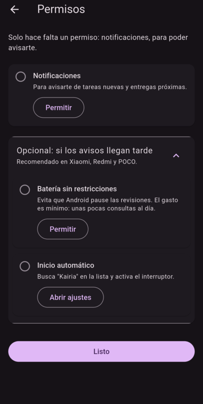

# Kairia

Recordatorios de entregas para el aula virtual de NovaUniversitas (Android).

> **App no oficial**, hecha por un estudiante. No está afiliada ni respaldada por la universidad.

## Qué hace

- Revisa tus tareas del aula unas 3 veces al día y te avisa cuando hay una nueva.
- Te recuerda 48 h, 24 h y 3 h antes de cada fecha límite.
- Muestra las instrucciones de cada tarea dentro de la app.
- Solo **lee** información: no entrega tareas ni modifica nada en el aula.

## Capturas

| Tus entregas | Detalle de la tarea | Permisos | Ajustes |
|:-:|:-:|:-:|:-:|
|  |  |  |  |

*Las capturas usan materias y tareas de ejemplo.*

## Instalar

**Necesitas Android 7.0 o más nuevo.** (Ajustes → Acerca del teléfono → Versión de Android)

1. Si tienes la versión vieja llamada **"Entregas"**, desinstálala primero.
2. Descarga **[kairia.apk](https://github.com/OmarDavidd/kairia/releases/latest/download/kairia.apk)** desde el celular.
3. Abre el archivo descargado (en la notificación de descarga o en la app **Archivos → Descargas**).
4. Si te pide permiso para **instalar apps desconocidas**, actívalo para tu navegador o la app de archivos y regresa.
5. Toca **Instalar**.
6. Abre Kairia, entra con tu usuario del aula y permite las **notificaciones**.

Las actualizaciones se instalan encima sin perder tu sesión. Kairia te avisa cuando hay una nueva.

### Si dice "No se instaló la app" o la bloquea

Kairia no viene de la Play Store, así que Android la trata con desconfianza aunque sea segura. Revisa en este orden:

| Lo que ves | Qué hacer |
|---|---|
| Aviso de **Play Protect** ("App no segura", "desarrollador desconocido") | Toca **Más detalles → Instalar de todas formas**. |
| Play Protect no da opción de instalar | Play Store → tu foto → **Play Protect** → ⚙️ → desactiva *Analizar apps* un momento, instala y **vuelve a activarlo**. |
| Xiaomi / Redmi / POCO: aviso de **análisis de seguridad** | Toca **Continuar** / **Instalar de todas formas**. |
| "No se instaló la app" sin más | 1) Borra el archivo y **descárgalo de nuevo** (pudo bajarse incompleto). 2) Revisa que tu Android sea **7.0 o más nuevo**. 3) Libera espacio: necesita unos 150 MB. |
| "Hubo un problema al analizar el paquete" | Tu Android es demasiado viejo, o el archivo está incompleto: descárgalo de nuevo. |

No envíes el APK por WhatsApp: a veces lo renombra o lo corta. Comparte mejor este enlace.

## Privacidad y seguridad

- Tu contraseña se guarda **cifrada solo en tu teléfono** y únicamente se envía al aula virtual.
- No hay servidores propios, analíticas ni publicidad.
- La app limita sus propias consultas al aula (máximo 60 por hora y 200 por día) y se pausa si el aula falla, para no saturarla.
- Cada versión está firmada con la misma llave. Android rechaza cualquier APK con otra firma que intente instalarse encima.
- Cada release incluye el SHA-256 del APK para que puedas verificarlo.

## Código

Este repositorio solo publica las versiones; el código fuente no es público.
