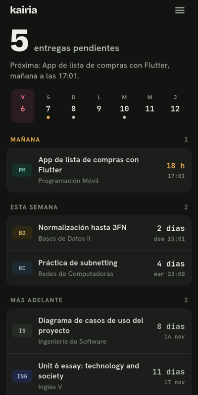
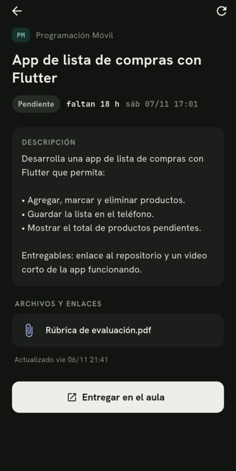
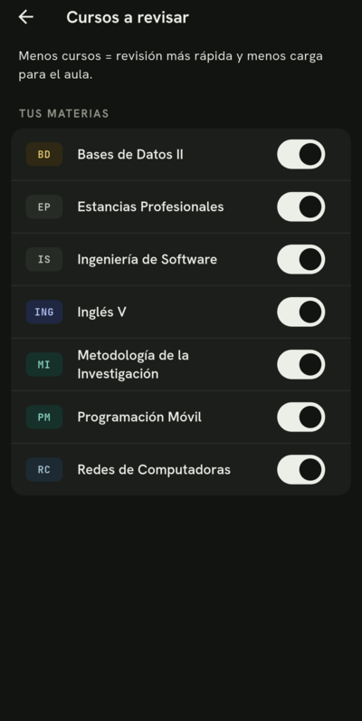
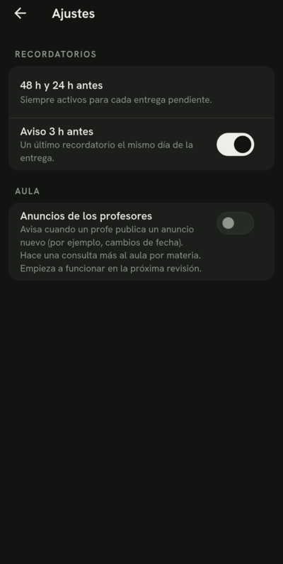

# Kairia

Recordatorios de entregas para el aula virtual de NovaUniversitas (Android).

> **App no oficial**, hecha por un estudiante. No está afiliada ni respaldada por la universidad.

## Qué hace

- Revisa tus tareas del aula unas 3 veces al día y te avisa cuando hay una nueva.
- Ordena tus entregas por urgencia: hoy, mañana, esta semana y más adelante.
- Desliza una tarea para marcarla como hecha u ocultarla si no es para ti.
- Te recuerda 48 h, 24 h y 3 h antes de cada fecha límite.
- Muestra las instrucciones de cada tarea dentro de la app.
- Solo **lee** información: no entrega tareas ni modifica nada en el aula.

## Capturas

| Tus entregas | Detalle de la tarea | Tus materias | Ajustes |
|:-:|:-:|:-:|:-:|
|  |  |  |  |

*Las capturas usan materias y tareas de ejemplo.*

## Instalar

**Requisito:** Android 7.0 o más nuevo.

1. Descarga **[kairia.apk](https://github.com/OmarDavidd/kairia/releases/latest/download/kairia.apk)** desde el celular.
2. Abre el archivo descargado (desde la notificación de descarga o en **Archivos → Descargas**).
3. Si Android lo pide, permite **instalar apps desconocidas** para tu navegador o tu app de archivos.
4. Toca **Instalar**.
5. Abre Kairia, entra con tu usuario del aula y permite las **notificaciones**.

Las actualizaciones se instalan encima sin perder tu sesión. Kairia te avisa cuando hay una nueva.

### Ayuda con la instalación

Como Kairia se instala fuera de la Play Store, Android puede mostrar avisos de seguridad. Es normal en cualquier app instalada así.

| Situación | Solución |
|---|---|
| Aviso de **Play Protect** | Toca **Más detalles → Instalar de todas formas**. |
| Aviso de **análisis de seguridad** (Xiaomi, Redmi, POCO) | Toca **Continuar** o **Instalar de todas formas**. |
| La instalación falla sin más detalles | Descarga el archivo de nuevo, revisa que tu Android sea 7.0 o más nuevo y que tengas al menos 150 MB libres. |
| "Problema al analizar el paquete" | El archivo está incompleto o tu Android es muy antiguo. Descárgalo de nuevo. |

Para compartir Kairia, comparte este enlace en lugar del archivo: algunas apps de mensajería modifican los APK.

## Privacidad y seguridad

- Tu contraseña se guarda **cifrada solo en tu teléfono** y únicamente se envía al aula virtual.
- No hay servidores propios, analíticas ni publicidad.
- La app limita sus propias consultas al aula (máximo 60 por hora y 200 por día) y se pausa si el aula falla, para no saturarla.
- Cada versión está firmada con la misma llave. Android rechaza cualquier APK con otra firma que intente instalarse encima.
- Cada release incluye el SHA-256 del APK para que puedas verificarlo.

## Código

Este repositorio solo publica las versiones; el código fuente no es público.
